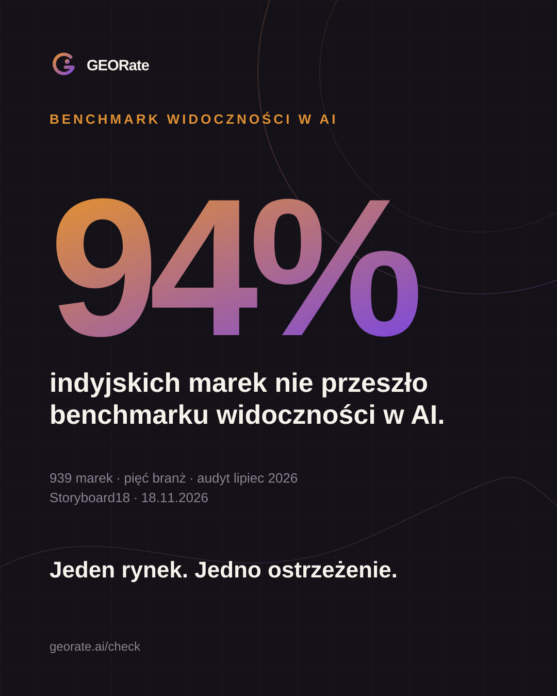
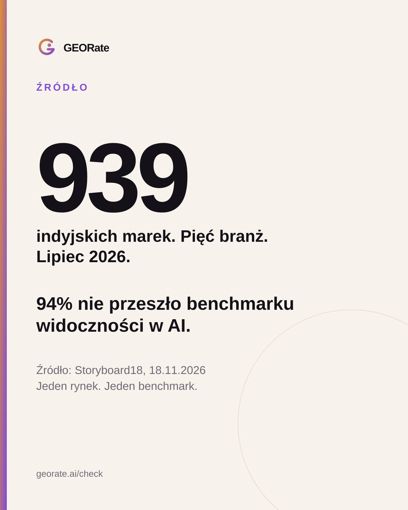
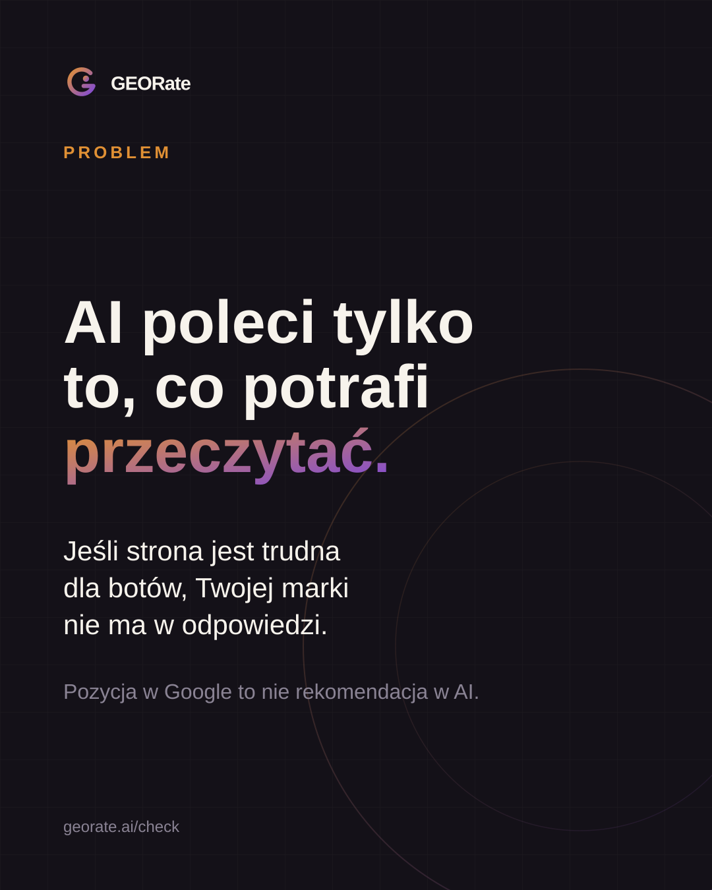
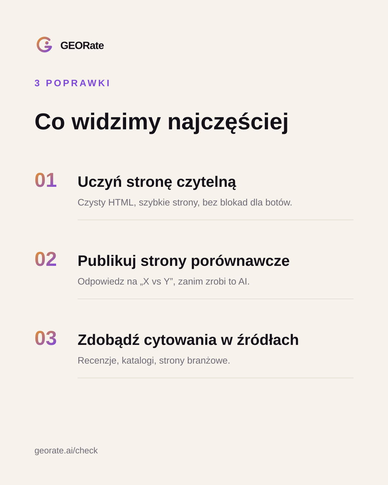
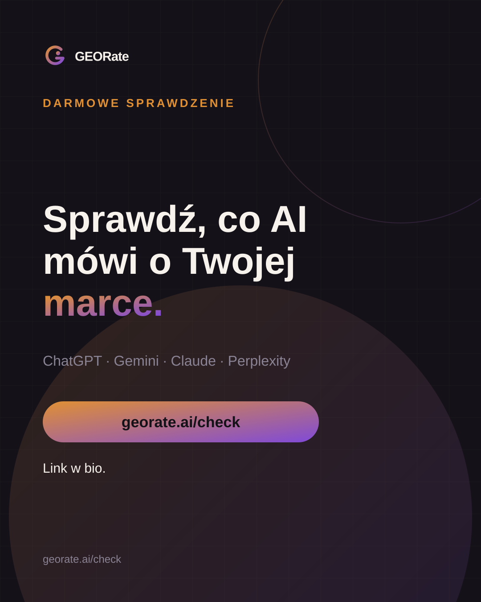
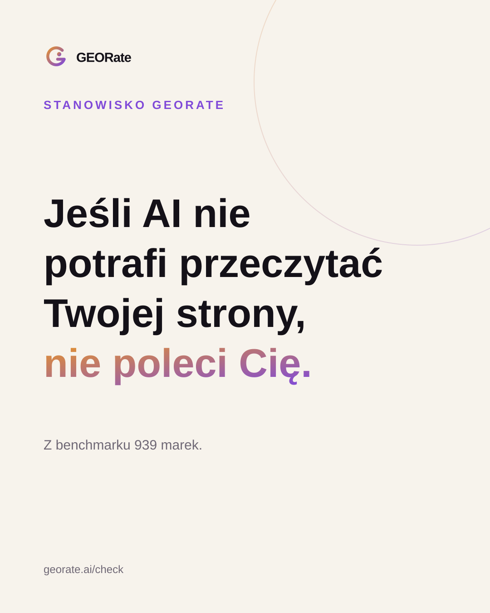
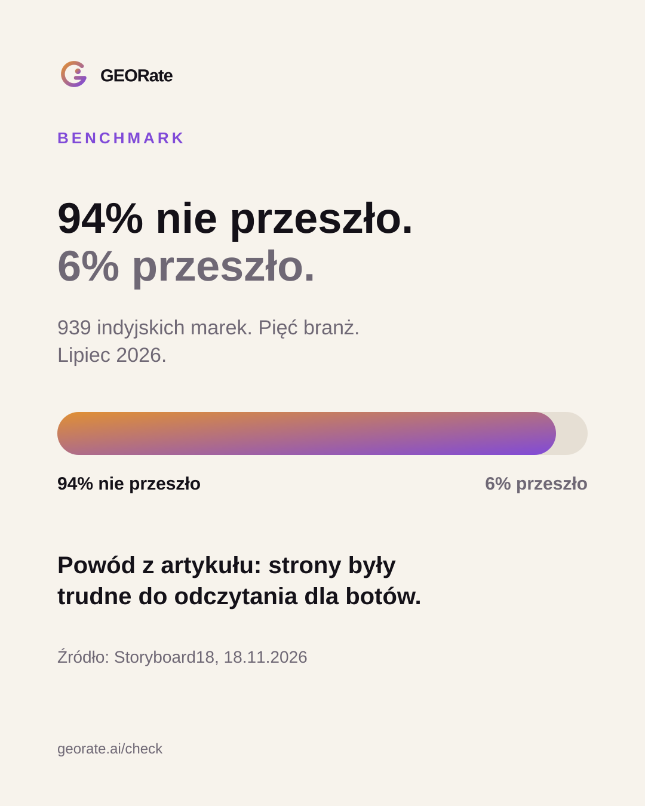

# GEORate — marketing assets

Publiczne, **zatwierdzone** assety marketingowe GEORate. Tylko rzeczy gotowe do publikacji. Strategia, drafty i notatki wewnętrzne zostają w prywatnym repo.

**Pages:** https://codeandlove.github.io/georate-marketing/

## Kampanie

### `ai-visibility-94` (PL, 2026-11-23)

Źródło: Storyboard18, 18.11.2026. Audyt 939 indyjskich marek w pięciu branżach (lipiec 2026). 94% nie przeszło podstawowego benchmarku widoczności w AI. Powód z artykułu: strony były trudne do odczytania dla botów.

- `site/campaigns/ai-visibility-94/linkedin.md` — post LinkedIn + pierwszy komentarz
- `site/campaigns/ai-visibility-94/instagram.md` — caption + slajdy + hashtagi
- `site/campaigns/ai-visibility-94/alt-text.md` — alt text
- `site/campaigns/ai-visibility-94/meta.json` — metadane kampanii
- `site/campaigns/ai-visibility-94/n8n-approval-payload.json` — payload do workflow `georate-marketing/approve`

#### LinkedIn

#### Instagram — carousel

#### Warianty dodatkowe

## Szablony

`templates/*.svg` — źródła grafik. Dane są wpisane na sztywno w tej kampanii; przy kolejnych kampaniach podmieniamy tekst i liczby.

## Zasady

- Tylko zatwierdzone assety.
- Zero sekretów, tokenów, webhooków i danych klientów.
- Każda liczba ma źródło i kontekst.
- Alt text jest częścią assetu.
- Logo jest tymczasowe (placeholder) — do podmiany na docelowe.

## Licencja

Wszystkie prawa zastrzeżone. Zobacz `LICENSE`. Assety są przeznaczone wyłącznie do komunikacji marketingowej GEORate.
